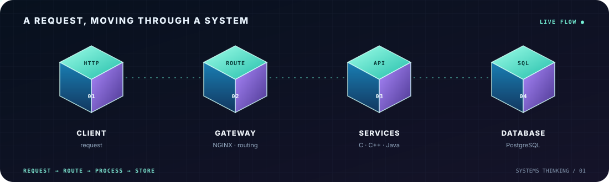

  
    
  <strong>Software engineering student · 1337 (42 Network)</strong> 
  Building backend systems and learning how each layer works.
    
  <a href="https://www.linkedin.com/in/amine-kella-99914b280/">LinkedIn</a> ·
  <a href="https://github.com/aminekell?tab=repositories">Explore my repositories</a>

---

### What I work with

- **Systems:** C, C++, Linux, Docker, NGINX
- **Backend:** Java, Spring Boot, REST APIs, PostgreSQL
- **Web:** JavaScript, TypeScript, React

### Systems in motion

  

A simple view of how a request can travel through a backend system.

### Selected work

| Project | What it is |
|---|---|
| [Inception](https://github.com/aminekell/Inception) | A Docker Compose stack with WordPress, MariaDB, NGINX, and bonus services. |
| [Java_Days](https://github.com/aminekell/Java_Days) | Java exercises and small object-oriented practice projects. |

### Contribution snake

Animated snake based on GitHub contribution activity.

<picture>
  <source media="(prefers-color-scheme: dark)" srcset="https://raw.githubusercontent.com/aminekell/aminekell/output/github-contribution-grid-snake-dark.svg" />
  <source media="(prefers-color-scheme: light)" srcset="https://raw.githubusercontent.com/aminekell/aminekell/output/github-contribution-grid-snake.svg" />
  
</picture>

### Currently curious about

Application security · rate limiting · networking · system design

---

  Learning by building. Improving by understanding.

