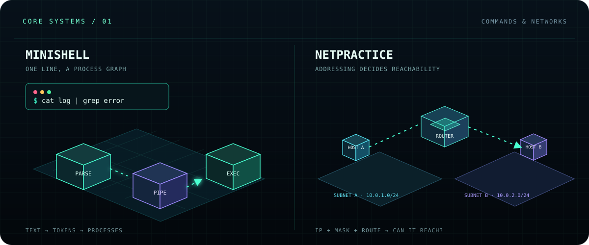
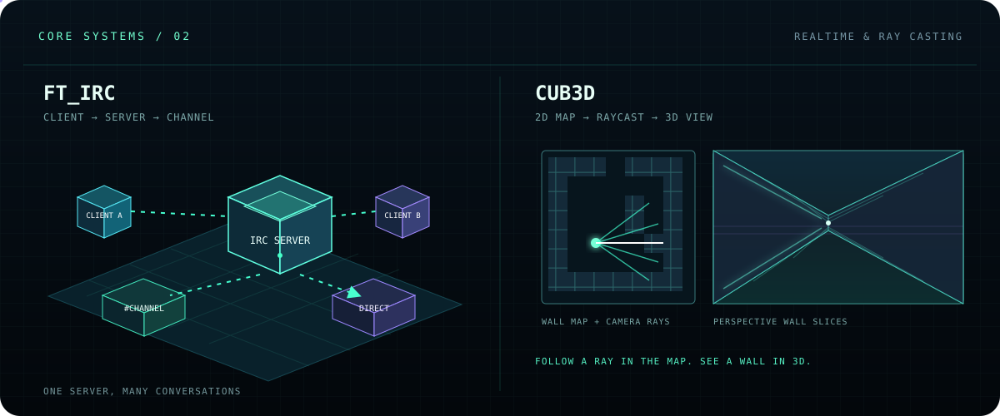
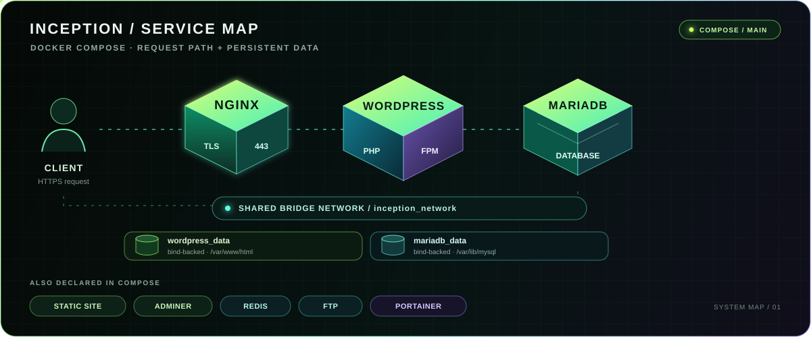
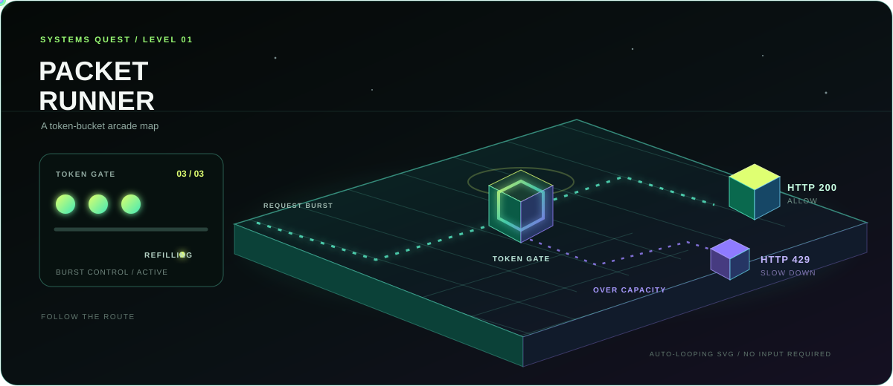
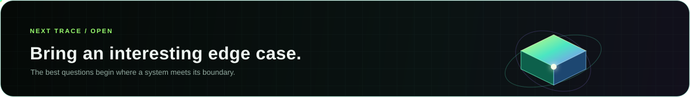

  

---

### 01 / Perspective

I’m drawn to the hidden mechanics of software: network boundaries, service relationships, and the assumptions behind a reliable system.

### 02 / Toolkit in progress

- **Systems** — C, C++, Linux
- **Backend** — Java, Spring Boot, REST APIs, PostgreSQL
- **Web** — JavaScript, TypeScript, React, HTML, CSS
- **Delivery** — Docker, NGINX, Git

### 03 / Core projects — systems in 3D

Four projects make hidden systems easier to see: commands become process flows, addresses become routes, messages travel through servers, and a grid becomes a first-person world.

- **minishell** — Turns a command into processes; pipes pass output between commands, while redirections connect files.
- **NetPractice** — IP addresses, subnet masks, and routes decide whether one host can reach another.
- **ft_irc** — Models a TCP chat server that connects clients and routes messages through channels.
- **cub3d** — Casts rays through a 2D map; the distance to each wall becomes part of a first-person 3D view.

  

  

### 04 / Fieldwork — Inception

[Inception](https://github.com/aminekell/Inception) is a Docker Compose environment. Its configuration routes HTTPS through NGINX to WordPress with PHP-FPM and MariaDB, connects services over a bridge network, and persists site and database data in bind-backed volumes. The same Compose file also declares a static site, Adminer, Redis, FTP, and Portainer.

  

  <a href="https://github.com/aminekell/Inception/blob/main/srcs/docker-compose.yml">Inspect the Compose configuration</a>

### 05 / A systems concept — Token buckets

A token bucket allows short bursts while limiting the sustained request rate. When the bucket is empty, an API can reject a request with HTTP 429 and refill tokens over time.

  

### 06 / Activity

This animation traces the contribution cells GitHub reports for my account.

<picture>
  <source media="(prefers-color-scheme: dark)" srcset="https://raw.githubusercontent.com/aminekell/aminekell/output/github-contribution-grid-snake-dark.svg" />
  <source media="(prefers-color-scheme: light)" srcset="https://raw.githubusercontent.com/aminekell/aminekell/output/github-contribution-grid-snake.svg" />
  
</picture>

  
  <a href="https://www.linkedin.com/in/amine-kella-99914b280/">LinkedIn</a> · <a href="https://github.com/aminekell?tab=repositories">Public repositories</a>

