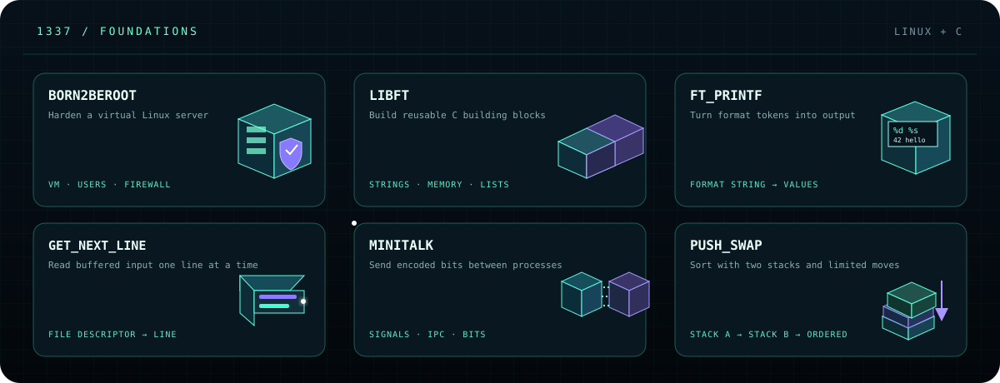
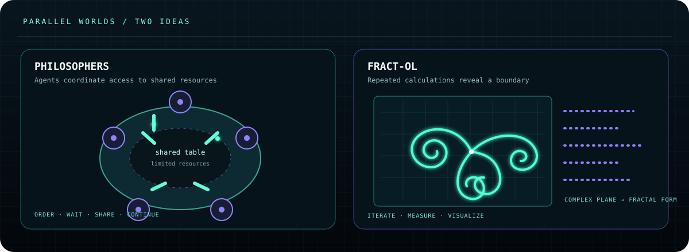
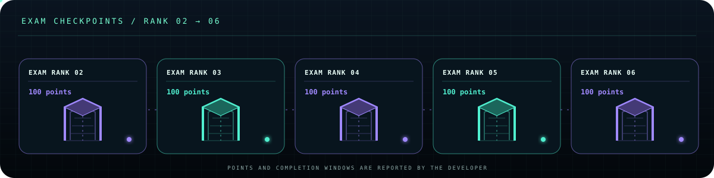

  

  <a href="https://aminekell.github.io/aminekell/"><strong>↗ OPEN THE INTERACTIVE SYSTEMS ATLAS</strong></a>

---

### 01 / Perspective

I’m drawn to the hidden mechanics of software: network boundaries, service relationships, and the assumptions behind a reliable system. My learning path includes the 1337 coding-school curriculum and ALX Software Engineering.

### 02 / Toolkit in progress

- **Systems** — C, C++, Linux
- **Backend** — Java, Spring Boot, REST APIs, PostgreSQL
- **Web** — JavaScript, TypeScript, React, HTML, CSS
- **Delivery** — Docker, NGINX, Git

### 03 / Core projects — systems in 3D

These projects make hidden systems easier to see: commands become process flows, addresses become routes, messages travel through servers, and a grid becomes a first-person world.

- **minishell** — A command becomes processes; pipes pass output between commands, while redirections connect files.
- **NetPractice** — IP addresses, subnet masks, and routes decide whether one host can reach another.
- **ft_irc** — A TCP chat server connects clients and routes messages through channels.
- **cub3d** — Rays pass through a 2D map; wall distance becomes a first-person 3D view.

  

  

### 04 / C & Linux foundations

- **Born2beroot** — Harden and administer a Linux server inside a virtual machine.
- **Libft** — Build reusable C building blocks for strings, memory, and linked lists.
- **ft_printf** — Read format tokens and turn values into formatted output.
- **get_next_line** — Buffer input and return it one line at a time.
- **minitalk** — Encode a message as bits sent between processes with signals.
- **push_swap** — Sort values using two stacks and a limited set of operations.

  

### 05 / Concurrency & computer graphics

**Philosophers** explores independent agents coordinating access to shared resources. **fract-ol** turns repeated calculations on the complex plane into detailed fractal boundaries.

  

### 06 / C++ — ten modules, one learning path

The C++ modules move from classes and memory through overloads, inheritance, exceptions, casts, templates, containers, iterators, and algorithms.

  

Exam Ranks 02–06 add five practical checkpoints. Each has a reported score of 100 points.

  

### 07 / Team delivery — ft_transcendence

We delivered ft_transcendence as a team project in under 15 days.

### 08 / Fieldwork — Inception

[Inception](https://github.com/aminekell/Inception) is a Docker Compose environment. Its configuration routes HTTPS through NGINX to WordPress with PHP-FPM and MariaDB, connects services over a bridge network, and persists site and database data in bind-backed volumes. The same Compose file also declares a static site, Adminer, Redis, FTP, and Portainer.

  

  <a href="https://github.com/aminekell/Inception/blob/main/srcs/docker-compose.yml">Inspect the Compose configuration</a>

### 09 / A systems concept — token buckets

A token bucket allows short bursts while limiting the sustained request rate. When the bucket is empty, an API can reject a request with HTTP 429 and refill tokens over time.

  

### 10 / Full course record

All 28 listed projects, modules, and exams — reported timing and score

Scores and completion timings below are transcribed from my record. A dash means no score was supplied.

#### Projects

| Project | Reported timing | Score (points) |
| --- | --- | ---: |
| Born2beroot | almost 2 years ago | 125 |
| Inception | 5 months ago | 125 |
| Libft | almost 2 years ago | 122 |
| NetPractice | about 1 year ago | 100 |
| Philosophers | about 1 year ago | 125 |
| cub3d | 12 months ago | 125 |
| fract-ol | over 1 year ago | 125 |
| ft_irc | 11 months ago | 125 |
| ft_printf | almost 2 years ago | 100 |
| get_next_line | almost 2 years ago | 125 |
| minishell | over 1 year ago | 110 |
| minitalk | over 1 year ago | 125 |
| push_swap | over 1 year ago | — |

#### C++ modules

| Module | Reported timing | Score (points) |
| --- | --- | ---: |
| CPP Module 00 | about 1 year ago | 80 |
| CPP Module 01 | about 1 year ago | 82 |
| CPP Module 02 | about 1 year ago | 80 |
| CPP Module 03 | about 1 year ago | 80 |
| CPP Module 04 | about 1 year ago | 100 |
| CPP Module 05 | 10 months ago | 100 |
| CPP Module 06 | 10 months ago | 100 |
| CPP Module 07 | 9 months ago | 100 |
| CPP Module 08 | 8 months ago | 100 |
| CPP Module 09 | 5 months ago | 100 |

#### Exam ranks

| Exam | Reported timing | Score (points) |
| --- | --- | ---: |
| Exam Rank 02 | over 1 year ago | 100 |
| Exam Rank 03 | over 1 year ago | 100 |
| Exam Rank 04 | about 1 year ago | 100 |
| Exam Rank 05 | 10 months ago | 100 |
| Exam Rank 06 | 5 months ago | 100 |

### 11 / Activity

This animation traces the contribution cells GitHub reports for my account.

<picture>
  <source media="(prefers-color-scheme: dark)" srcset="https://raw.githubusercontent.com/aminekell/aminekell/output/github-contribution-grid-snake-dark.svg" />
  <source media="(prefers-color-scheme: light)" srcset="https://raw.githubusercontent.com/aminekell/aminekell/output/github-contribution-grid-snake.svg" />
  
</picture>

  
  <a href="https://www.linkedin.com/in/amine-kella-99914b280/">LinkedIn</a> · <a href="https://github.com/aminekell?tab=repositories">Public repositories</a>

