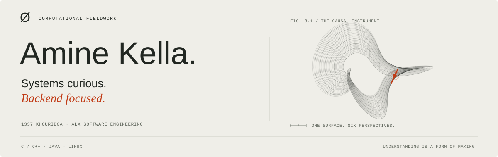

<a href="https://aminekell.github.io/aminekell/">
  <picture>
    <source media="(prefers-color-scheme: dark)" srcset="https://raw.githubusercontent.com/aminekell/aminekell/main/assets/profile-cover-dark.svg" />
    
  </picture>
</a>

  <a href="https://aminekell.github.io/aminekell/"><strong>Explore my portfolio ↗</strong></a>
  &nbsp; · &nbsp;
  <a href="https://github.com/aminekell?tab=repositories">Repositories</a>
  &nbsp; · &nbsp;
  <a href="https://www.linkedin.com/in/amine-kella-99914b280/">LinkedIn</a>

 

I'm Amine, a **software engineering student at 1337 Khouribga**. I like understanding what happens underneath: how processes communicate, how services connect, and how a system holds together. My learning path also includes **ALX Software Engineering**.

My current focus is **Java, Spring Boot, and backend development**, grounded in C, C++, and Linux.

### 01 / Selected work

| Project | What I explored |
| :--- | :--- |
| **[Portfolio](https://aminekell.github.io/aminekell/)** | Selected projects, source code, and browser experiments. |
| **[HirePath · ft_transcendence](https://github.com/aminekell/42-ft-transcendence)** | A team recruitment platform with React, NestJS, and Spring Boot. I worked on company profiles, onboarding, and dashboard integrations. |
| **[Inception](https://github.com/aminekell/Inception)** | Docker Compose, NGINX, WordPress, and MariaDB. HTTPS, service networking, and persistent storage. |
| **[Minishell](https://github.com/aminekell/42-minishell)** | A shell built around parsing, processes, pipes, and redirections. |
| **[cub3D](https://github.com/aminekell/42-cub3d)** | A first-person view built from a 2D map using raycasting. |
| **[ft_irc](https://github.com/aminekell/42-ft-irc)** | A C++98 IRC server with nonblocking sockets, channels, and message routing. |
| **[Philosophers](https://github.com/aminekell/42-philosophers)** | A C simulation exploring concurrency with POSIX threads, mutexes, and semaphores. |

### 02 / My workbench

| Area | Tools |
| :--- | :--- |
| **Backend** | Java · Spring Boot · REST APIs · PostgreSQL |
| **Systems** | C · C++ · Linux |
| **Web** | JavaScript · TypeScript · React · HTML · CSS |
| **Delivery** | Docker · NGINX · Git |

### 03 / Foundations

The 1337 curriculum took me through memory, concurrency, networking, and graphics. Explore the source and build instructions for each published project.

<strong>Browse all 21 published 42 projects</strong>

| Area | Repositories |
| --- | --- |
| Applications and infrastructure | [HirePath](https://github.com/aminekell/42-ft-transcendence) |
| Systems and C libraries | [Minishell](https://github.com/aminekell/42-minishell) · [Philosophers](https://github.com/aminekell/42-philosophers) · [Minitalk](https://github.com/aminekell/42-minitalk) · [Libft](https://github.com/aminekell/42-libft) · [ft_printf](https://github.com/aminekell/42-ft-printf) · [get_next_line](https://github.com/aminekell/42-get-next-line) |
| Networking and graphics | [ft_irc](https://github.com/aminekell/42-ft-irc) · [NetPractice](https://github.com/aminekell/42-netpractice) · [cub3D](https://github.com/aminekell/42-cub3d) · [fract-ol](https://github.com/aminekell/42-fractol) |
| C++98 modules | [C++ 00 · Fundamentals](https://github.com/aminekell/42-cpp00) · [C++ 01 · Memory and references](https://github.com/aminekell/42-cpp01) · [C++ 02 · Fixed point](https://github.com/aminekell/42-cpp02) · [C++ 03 · Inheritance](https://github.com/aminekell/42-cpp03) · [C++ 04 · Polymorphism](https://github.com/aminekell/42-cpp04) · [C++ 05 · Exceptions](https://github.com/aminekell/42-cpp05) · [C++ 06 · Casts](https://github.com/aminekell/42-cpp06) · [C++ 07 · Templates](https://github.com/aminekell/42-cpp07) · [C++ 08 · Containers](https://github.com/aminekell/42-cpp08) · [C++ 09 · STL algorithms](https://github.com/aminekell/42-cpp09) |

<strong>Open my full course record</strong> — projects, C++ modules, and exams

Scores from my course record. A dash means no score was listed.

#### Projects

| Project | Score |
| --- | ---: |
| Born2beroot | 125 |
| Inception | 125 |
| Libft | 122 |
| NetPractice | 100 |
| Philosophers | 125 |
| cub3d | 125 |
| fract-ol | 125 |
| ft_irc | 125 |
| ft_printf | 100 |
| get_next_line | 125 |
| minishell | 110 |
| minitalk | 125 |
| push_swap | — |

#### C++ modules

| Module | Score |
| --- | ---: |
| CPP Module 00 | 80 |
| CPP Module 01 | 82 |
| CPP Module 02 | 80 |
| CPP Module 03 | 80 |
| CPP Module 04 | 100 |
| CPP Module 05 | 100 |
| CPP Module 06 | 100 |
| CPP Module 07 | 100 |
| CPP Module 08 | 100 |
| CPP Module 09 | 100 |

#### Exam ranks

| Exam | Score |
| --- | ---: |
| Exam Rank 02 | 100 |
| Exam Rank 03 | 100 |
| Exam Rank 04 | 100 |
| Exam Rank 05 | 100 |
| Exam Rank 06 | 100 |

Contribution trail

An animated trace of my GitHub contributions.

<picture>
  <source media="(prefers-color-scheme: dark)" srcset="https://raw.githubusercontent.com/aminekell/aminekell/output/github-contribution-grid-snake-dark.svg" />
  
</picture>

 

---

*Understanding is a form of making.*

[Start a conversation ↗](https://www.linkedin.com/in/amine-kella-99914b280/)
